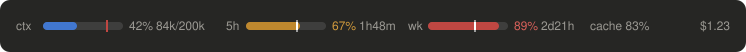
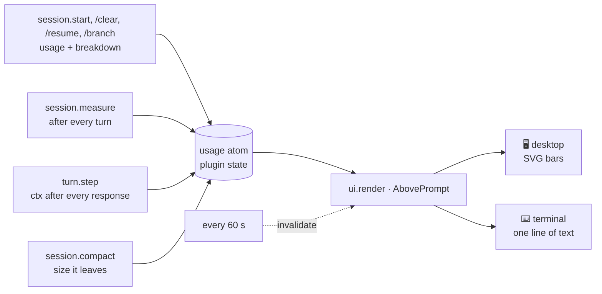

<div align="center">

# 📶 usage-band

[](https://github.com/zexion7873/usage-band/actions/workflows/check.yml)



**Context fill and every rate-limit window, always on, right above the Claude
Code prompt — in the desktop app's Code tab as well as the terminal.**

[](LICENSE)
[](#%EF%B8%8F-desktop-and-terminal)
[](#-how-it-works)

No status-line script. No network requests. No model calls. One mod reading
Claude Code's own session usage.

</div>

---

## 🚀 Install

### 🤖 Hand it to your agent

Paste this and walk away:

```text
Fetch and follow https://raw.githubusercontent.com/zexion7873/usage-band/main/llms-install.md
```

It installs from the CLI and verifies the install. Recipe in
[llms-install.md](llms-install.md).

### 🧑 Or type it yourself

From inside a Claude Code terminal session:

```text
/plugin marketplace add zexion7873/usage-band
/plugin install usage-band@usage-band
```

Pick the user scope. The band appears in that session at once. Installed at the
user scope, it also loads in sessions the desktop app starts — the desktop Code
tab cannot run `/plugin` itself, so install from a terminal once.

> [!IMPORTANT]
> **Requirements:** a Claude Code build with function-hook plugins (mods). CI
> validates and tests against Claude Code 2.1.308; older builds are unmeasured.

---

## 📊 What it shows

|   | Item | Meaning |
|:-:|------|---------|
| 🧠 | **`ctx`** | Context window fill, `tokens/window` beside it. A red tick marks where auto-compact triggers, white where the fill has passed it. |
| ⏱️ | **`5h`**, **`wk`** | Each rate-limit window: percent used and time until it resets. A grey tick marks the share of the window already elapsed, white where the fill has passed it — a fill past the tick is burning faster than an even pace. Once a window has moved since your last message, `+N%` beside its percent says how far, and the window's card on the desktop repeats it. The windows are the account's, so every session on it counts toward that step, not only this one. |
| 💳 | **`spend`** | The spend limit, when the account has one. |
| ♻️ | **`cache N%`** | Cache reads as a share of all input tokens in the last response. |
| 💵 | **`$N.NN`** | Session cost at API token prices. On a subscription this is not what you are billed — your plan counts against the `5h` / `wk` limits. On the desktop it is in the card that opens over `cache`, so the meters keep one row however large it grows. |

Percent turns amber at 60% and red at 85%.

When a `5h` or `wk` window is on course to run out before it resets, at the
rate it has burned so far, a toast says so once per window: `5h runs out in
~40m, before its 15:00 reset`. Claude Code's own notice comes near the limit;
this one comes while there is still time to slow down.

### 🖥️ Desktop and terminal

On the desktop each meter is a bar. Hover it for a card with its detail, which a
screen reader also reads:

- **`ctx`**: the compact point and the five largest context categories. Their
  sizes are a local estimate (`~`) and can differ from `/context`, which counts
  them exactly. Each square marks a rank the way `/context` colours its own —
  blue, orange, green, amber, then grey — so where the two rankings differ, a
  category's colour differs too. In every card, a line that comes and goes
  opens with a grey square, so a coloured one always marks a rank.
- **A rate-limit window**: how much of the window has elapsed and the local
  time it resets; then, when they apply, where it ends up if the rest of it
  burns at the rate so far — in amber when that runs it out before the reset —
  and how far it moved since your last message.

The terminal draws the headline figures as one line of text:

```text
ctx 42% (84k/200k) · 5h 67% (1h48m) · wk 89% (2d21h) · cache 83% · $1.23
```

In a terminal too narrow for all of it, the line stays one line and ends in
`…`; the cost goes first, then the cache.

Reset countdowns and pace ticks keep moving while the session sits idle — the
band redraws once a minute rather than waiting for the next response. A window
whose reset passes while the session sits idle reads `— (reset)` until the next
response brings its new figure; not `0%`, since other sessions on the account may
already have spent from the new window. A session that starts with no reading
yet — a new one, or one the desktop app relaunched while it sat idle — holds
`5h` and `wk` at `—` until the first response says which windows the account has.

### 🎯 Use cases

- **Compact on your terms.** Before starting a long task, compare the desktop
  `ctx` fill with its red tick. Close to the tick, run `/compact` or start a fresh
  session now, instead of having auto-compact fire halfway through the work.
- **Pace a rate-limit window.** On the desktop, when the `5h` fill runs past its tick, you
  are spending faster than an even pace and will hit the limit before it
  resets. The countdown beside it says how long the rest has to last.
- **See usage in the desktop app at all.** In the Code tab, where status-line
  meters never run, glance above the prompt instead of opening the usage panel.

---

## 🖥️ Desktop and terminal

A `statusLine` command never runs in the desktop Code tab, so every status-line
usage meter is invisible there. usage-band is a **mod** — a plugin of function
hooks — and draws into the prompt area itself, which both surfaces render.

It steps aside while Claude Code shows a survey above the prompt, and keeps
whatever other plugins drew beneath it.

---

## 🔧 How it works



Every figure comes from Claude Code's own session usage, read locally. The mod
writes no files, opens no ports, and makes no network requests or model calls —
`claude plugin validate plugin` prints every engine call it makes.

Every hook hands its event on unchanged. `classic.SessionStart` (after
`/clear`, `/resume` and `/branch`) only re-reads the usage, and
`prompt.submit` only notes each window's reading as the base for `+N%` —
neither adds context nor touches your prompt.

---

## 🩺 Troubleshooting

| Symptom | Check |
|---|---|
| No band at all | `claude plugin list` should show `usage-band@usage-band` as loaded. A session picks up plugins only when it starts, so open a new one after installing or updating. Mods also need a recent Claude Code — see Requirements. The band draws in a terminal session (an editor's integrated terminal included) and the desktop app's Code tab; the VS Code extension's panel and the mobile app draw none. |
| Band missing for a moment | It steps aside while Claude Code shows a survey above the prompt, and draws nothing until the session has started. |
| No `5h` / `wk` / `spend` | Only the windows Claude Code reports for your account are drawn; `spend` appears only with a spend limit. |
| A figure looks wrong | Compare it with Claude Code's own usage panel, then [open a bug](https://github.com/zexion7873/usage-band/issues/new?template=bug.yml) with both values and where you ran it. |

---

## 🧹 Uninstall

```text
/plugin uninstall usage-band@usage-band
```

The mod writes nothing to disk of its own, so there is nothing else to clean up.

---

## 🛠️ Develop

```bash
claude plugin validate --strict plugin
claude plugin test plugin
```

[CONTRIBUTING.md](CONTRIBUTING.md) has the dev loop and the traps worth
knowing first; [AGENTS.md](AGENTS.md) has the rest.

---

## ⚖️ Disclaimer

Unofficial community project. Not affiliated with, endorsed by, or sponsored by
Anthropic.
